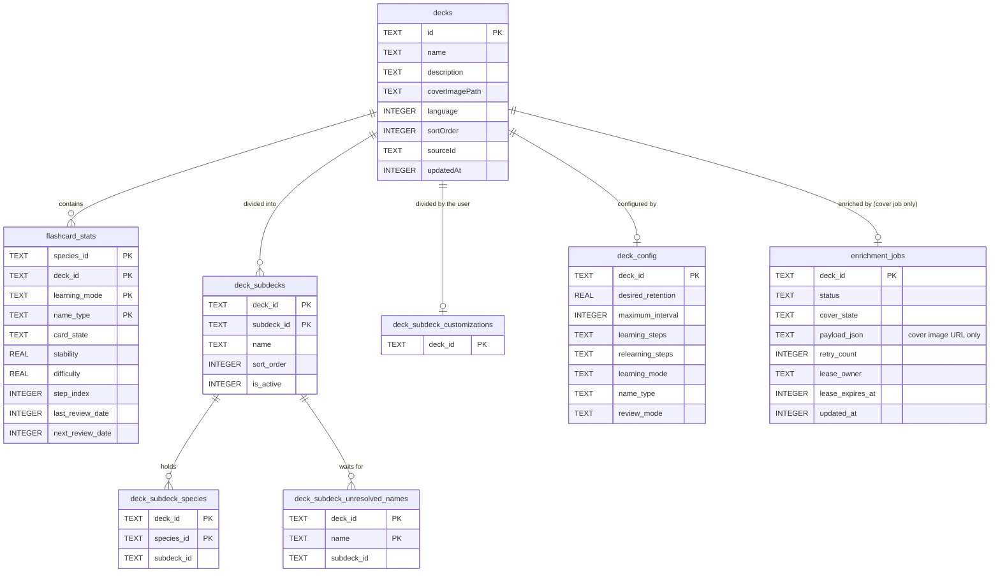

# Discere – Architecture Overview

## 1. What is Discere?

Discere is a **Flutter-based flashcard app** (Android + iOS) for learning biological species (primarily marine life). Users create or import decks of species, review flashcards using the FSRS 6 spaced-repetition algorithm, and track their learning progress. The app supports offline use, push notifications for due reviews, deck sharing via QR / JSON / text, and full DE/EN localization.

---

## 2. Architectural Style

> **Service-Oriented Layered Architecture with Provider-based DI**

The app uses a **3-layer service-repository architecture** wired via Provider-based dependency injection. It is not BLoC, not Clean Architecture, and not MVVM in a formal sense — though it shares traits with all three.

| Trait | In Discere |
|---|---|
| **Dependency Injection** | Manual constructor injection; wired in `lib/app/bootstrap/bootstrap_app.dart` and exposed via `MultiProvider`. |
| **State propagation** | `ChangeNotifier` + `Consumer` / `Provider.of`. Some services are `ChangeNotifier`, others are plain `Provider`. |
| **Data flow** | UI → Service → Repository → SQLite (via `DatabaseHelper`). |
| **Navigation** | Imperative `Navigator.push` with `MaterialPageRoute`. No declarative router. |
| **Separation of concerns** | Vertical separation by feature module (`shared`, `external`, `diagnostics`, `catalog`, `enrichment`, `learning`, `app`). Module dependency rules are enforced by architecture tests. |

**Widget organization.** Within a slice, pages follow `page` (StatefulWidget) → `presenter` → `view_model`: pure derived-state computation (dirty-tracking, validity checks, result merging, label/icon mapping) lives in a presenter class next to the widget, not inline in `State` — see `learning/decks/edit_deck_presenter.dart`, `learning/flashcard/deck_session_presenter.dart`, `catalog/search/search_results_presenter.dart`. Async orchestration coupled to `BuildContext`/`setState`/`mounted` (network calls, permission flows, navigation sequencing) stays directly in the State class regardless of size — that's not what a presenter is for (see `_BootstrapAppState` in `app/bootstrap/bootstrap_app.dart`, or `DeckPage`'s tutorial-scheduling methods). Once a page accumulates several large, self-contained private widgets — alternate full-screen states, dialogs, sections — each is split into its own file in the same directory as a public class, even if only used from one place: see `learning/flashcard/`, `learning/decks/edit/`, `app/bootstrap/`.

**Naming.** A class-name suffix from the table below states what the class *is* — how it is reached, or which layer it sits in — and a class that is something else does not take it:

| Suffix | Meaning | Examples |
|---|---|---|
| `Page` | Its own route, pushed with `Navigator.push`. One deliberate case: `SpeciesDetailPage` is the loaded full-screen state of `SpeciesDetailLoaderPage`, which is the route | `EditDeckPage`, `MainScreenPage` |
| `Tab` | Content of a tab container (`IndexedStack`, `TabBarView`); no route, no `Scaffold` of its own | `DecksTab`, `WatchlistTab`, `ImportTextTab` |
| `App` | Root widget passed to `runApp()`; wraps or replaces a `MaterialApp`, never routed | `BootstrapApp`, `FlashcardApp` |
| `Shell` | One alternative full-screen state of a state-machine root widget, picked in its `build()` | `BootstrapShell`, `ReferenceDbDownloadShell` |
| `Dialog` / `Sheet` | Shown via `showDialog` / a modal bottom sheet | `ActivateMoreCardsDialog`, `AddToDeckSheet` |
| `Section` | A self-contained block within a page, dialog or sheet — usually titled, often framed by a `SectionCard` | `SpeciesSummarySection`, `TaxonomyCommonNamesSection`, `LearningSettingsSection` |
| `Presenter` | Pure derived-state computation for a widget; not a widget | `EditDeckPresenter`, `DeckSessionPresenter` |
| `ViewModel` | Data carrier a presenter or widget renders | `DeckViewModel`, `TaxonomyDetailViewModel` |
| `Service` | Business logic, often a `ChangeNotifier` provided via Provider | `DecksService`, `TaxonomyService` |
| `Repository` | Raw SQL / persistence | `DeckRepository`, `SpeciesRepository` |
| `Api` | Client for a third-party API, under `external/` | `INatPhotoApi`, `WikipediaApi` |
| `Port` / `Adapter` | Inverts a cross-slice dependency: the lower slice declares the port, the wiring file implements it as an adapter (see "Dependency Injection" in `CLAUDE.md`) | `DeckSpeciesSnapshotPort`, `_DeckSpeciesSnapshotAdapter` |

Every other suffix is descriptive and free: `Card`/`Tile`/`Item` for list entries, `Info`/`Status`/`Result`/`Snapshot` for values, `Content` for the body a page, tab or other widget frames, `Header`, `Banner`, `Field`, `Button`, and so on. None of these says anything about routing or layering, so a rule choosing between `Card` and `Tile` would claim a precision the distinction does not have.

Widget key strings are snake_case, `<feature>_<element>`: `Key('edit_deck_save_button')`, `ValueKey('nav_watchlist')`.

**Feature ownership vs. slice-level flat dirs.** A file only belongs in a slice's flat `model/`/`repository/`/`service/` (e.g. `learning/service/`) if it's genuinely used by two or more feature folders within that slice, or by `app/` for composition — judge this from actual callers, not the file's name or type. If every real caller sits inside a single feature folder (including "called only by another file that already lives in that feature folder"), the file belongs inside that feature folder instead, even if it's a service or repository rather than a widget. This cuts both ways over a class's lifetime: a slice-level service that starts out shared can accrete feature-only methods as it grows, and should be split back apart once that happens — the shared remainder stays flat, the feature-only remainder moves into that feature's folder. Worked example: `learning/service/flashcard_service.dart` kept only the deck config/stat/notification surface genuinely shared with `decks/` and `app/`; the FSRS grading, due-card sourcing, and photo-gap tracking — used only from within `flashcard/` — moved to `learning/flashcard/service/flashcard_review_service.dart`.

Once a feature folder's own repository/service files start to accumulate (roughly 3+), split them into their own `service/`/`repository/` subfolders inside that feature folder, the same way `enrichment/queue/` and `enrichment/pipeline/` already do — see `learning/flashcard/service/` and `learning/flashcard/repository/`. Presenters/view_models/widgets stay flat in the feature folder itself either way; only the persistence/business-logic layers get pulled into subfolders.

---

## 3. Layer Diagram

```
┌────────────────────────────────────────────────────────────┐
│                         UI Layer                           │
│  app/  •  catalog/  •  learning/  •  enrichment/           │
│  (StatefulWidget + FutureBuilder + Consumer)               │
└────────────────────────┬───────────────────────────────────┘
                         │  Provider.of / Consumer
┌────────────────────────▼───────────────────────────────────┐
│                     Service Layer                          │
│                                                            │
│  learning/           enrichment/         catalog/          │
│  DecksService        INatEnrichment      WatchlistService  │
│  FlashcardService    QueueService        SourceService     │
│  DeckImportService   BaseWorker          LocalSpecies      │
│                      INatWorker          ImageService       │
│  learning/flashcard/ CoverJobRunner      SpeciesInat        │
│  DeckSessionService  SpeciesPhotoService MetadataService    │
│  FlashcardReview-                                            │
│    Service           SpeciesMediaService                    │
│  FsrsService         (enrichment→catalog composition point) │
│  MultipleChoice-                                             │
│    DistractorPool-                                           │
│    Service                                                   │
│                                                            │
│  external/                        shared/                  │
│  INatPhotoApi, INatSearchApi, …   ImageService              │
│  WikipediaApi                     NotificationService       │
│                                    LanguageService            │
│  diagnostics/                     UserPreferencesService     │
│  LocalDiagnostics                                            │
└────────────────────────┬───────────────────────────────────┘
                         │  direct method calls
┌────────────────────────▼───────────────────────────────────┐
│                  Persistence Layer                         │
│                                                            │
│  DatabaseHelper (static, dual-DB singleton)                │
│  learning/: DeckRepository, FlashcardStatRepository,        │
│    DeckConfigRepository                                     │
│  learning/flashcard/: SpeciesPhotoGapAckRepository           │
│  catalog/: SpeciesRepository, SearchRepository,              │
│    SourceRepository, ExternalIdRepository,                  │
│    ExternalIdCacheRepository                                 │
│  enrichment/: EnrichmentWorkRepository,                      │
│    EnrichmentJobRepository (cover job only),                 │
│    INatPhotoCacheRepository, RuntimeCommonNameRepository     │
│  diagnostics/: LocalDiagnosticsRepository                    │
└────────────────────────┬───────────────────────────────────┘
                         │  sqflite
┌────────────────────────▼───────────────────────────────────┐
│                Data / Storage                              │
│                                                            │
│  discere_reference.db  (read-only, downloaded at runtime)  │
│  discere_user.db       (read-write, user data)             │
│  SharedPreferences     (language, favorites, watchlist,    │
│                         global default retention)          │
│  Local filesystem      (cached images, deck covers)        │
└────────────────────────────────────────────────────────────┘
```

---

## 4. Module Structure

The app is split into feature modules with explicit dependency rules.

### `shared/`
Dependency-free foundation. Generic infrastructure and cross-cutting helpers only — nothing domain-specific belongs here.
- `DatabaseHelper`, `ReferenceDatabaseProvisioner` (`persistence/`); `ReferenceDbUpdateService` beside them, where a session stands with a newer reference DB (§5.3); `ReferenceIdMigration` (`persistence/reference_id/`), which rewrites the reference IDs in the user data through the installed reference DB's `entity_aliases` (see §5.3); `closed_database_tolerance.dart` beside them is the one place a `DatabaseException` is caught — a database closed underneath a call is dropped quietly, every other database error propagates (ARCH-16)
- `ImageService`, `LanguageService`, `UserPreferencesService`, `NotificationService`, `NetworkAvailability` (`service/`)
- `LoggingHttpClient`, `Logger` (`util/`) — `Logger.warn`/`error` take an optional error and stack trace, written with the entry (stack cut to its first frames)
- `FailureLogging.warnOnFailure` (`util/failure_logging.dart`) — for an error the UI *shows* rather than awaits. A `FutureBuilder` that renders an error, or a `catch` that turns it into a snack bar, has handled it, so it never reaches the uncaught-error log. The rule: log where the error is caught, never in `build`. A future a `FutureBuilder` consumes is wrapped with `warnOnFailure(_log, '<what>')` where it is created (`initState`, a reload), which logs `<what> failed` with error and stack trace once and passes the error on unchanged; a `catch` logs with `_log.warn('<what> failed', error: e, stackTrace: stackTrace)`. Logged from `build`, one failure would add an entry per rebuild. An error already logged where it arose (a service, a fallback) is not logged again at the widget that shows it
- Generic UI primitives and utilities

### `external/`
HTTP clients for third-party APIs, one subfolder per provider. Depends only on `shared`; knows nothing about the app's domain slices.
- `INatPhotoApi`, `INatCommonNameApi`, `INatSearchApi`, `INatMetadataApi` (`inaturalist/` — what consumers inject), over `INatApiClient`, `INatTaxonIdResolver` and `INatTaxonDetails`
- `WikipediaApi` (`wikipedia/`)

### `diagnostics/`
Local, on-device diagnostics: structured event/telemetry recording and HTTP-failure logging.
- `LocalDiagnostics`, `LogDiagnosticsPersistence` (`service/`)
- `LocalDiagnosticsRepository` (`repository/`)

### `catalog/`
The reference catalog domain: species, taxonomy, search, source metadata, catalog UI.
- `SpeciesRepository`, `SearchRepository`, `SourceRepository`, `ExternalIdRepository`, `ExternalIdCacheRepository` (`repository/`)
- `SourceService`, `WatchlistService`, `SpeciesSearchService` (`service/` — what more
  than one catalog feature uses); `SpeciesInatMetadataService` and
  `TaxonomyService` in their own feature's `service/`
- Species detail and taxonomy detail pages, watchlist tab

### `enrichment/`
Producer-consumer background pipeline that fetches and caches species photos
and common names from iNaturalist. Four feature-based subfolders — `queue/`
(deck-level job tracking/orchestration/UI-facing status), `pipeline/`
(species-level work queue + the two workers), `media/` (on-demand
species-image display, unrelated to the background queue — including
`LocalSpeciesImageService`, which resolves pictures to files on disk), `ports/` (shared
cross-cutting port interfaces). See [`docs/enrichment.md`](./enrichment.md)
for the full design.
- `INatEnrichmentQueueService`, `DeckEnrichmentScheduler`, `CoverJobRunner`
  (`queue/service/`) — the queue service is the entry point and does the
  lifecycle/foreground orchestration; the scheduler brings decks into the
  queue and takes them out again; the cover runner is the one remaining
  sequential job (deck cover image)
- `BaseWorker`, `INatWorker` (`pipeline/service/`) — the two independently-
  scheduled workers draining the shared species/taxonomy work queue
- `BaseImageEnrichmentService`, `INatPhotoEnrichmentService`,
  `SpeciesCommonNameEnrichmentService`, `TaxonomyCommonNameEnrichmentService`,
  `INatNameResolutionService` (`pipeline/service/`) — the actual iNaturalist/
  reference-image fetches the workers call
- `SpeciesMediaService` (`media/service/`) — composition point over `catalog`
  (species/images), used by `learning` and `app`. Its two bulk entry points
  share one implementation and differ only in whether missing images are
  downloaded: `resolveAllFromCache` renders from what is on disk,
  `resolveAllWithDownload` fetches what is missing. Both read the two databases
  in one bundled pass, so the number of queries does not grow with the number of
  species, and both answer in the order the caller asked for rather than the
  taxonomic order the species load returns — which is what lets a list render
  the cached pass and adopt the downloaded one later without resorting itself.
  The external (iNaturalist) downloads inside the second pass are strictly
  serial, as that host's rate limit requires; nothing on screen waits for that
  call (see §7.3), so serialising it costs no screen time.
  `resolveSpeciesFromCache` is the cached pass for a caller that already holds
  its species — the edit-deck page's species list (`EditDeckSpeciesList`) — and
  skips the species load: one photo-cache read and one path resolution, in the
  order of the list it was handed.
  `findSpeciesWithoutLocalImage` answers the narrower "does this species have a
  picture on disk at all" from the candidate URLs alone, without that taxonomy
  load.
- `SpeciesThumbnailService` (`media/service/`) — the thumbnail of a species
  row in the `catalog` and `learning` lists, behind `catalog`'s
  `SpeciesThumbnailPort`: a cached iNaturalist photo if enrichment has one,
  else the photo of the taxon `INatTaxonResolver` assigns, by the same rules
  as enrichment and the species page
- `EnrichmentWorkRepository` (species/taxonomy queue), `EnrichmentJobRepository`
  (cover job only), `INatPhotoCacheRepository`, `RuntimeCommonNameRepository`
  (`pipeline/repository/` and `queue/repository/`)
- `EnrichmentCapability`, `EnrichmentWorkState`, `DeckEnrichmentProjection`
  (`model/`) and `EnrichmentFailureClassifier`, `DeckMembershipLock`
  (`service/`) — the types both `queue/` and `pipeline/` need, kept at slice
  level so `pipeline/` never has to import from `queue/`. The lock keeps deck
  scheduling and the `INatWorker`'s straggler round from interleaving: both
  write deck membership, and the ownership planner treats the scheduler's
  species snapshot as authoritative. The two enums carry an explicit
  `wireName`, so the strings in the queue tables are written in exactly one
  place.

### `learning/`
Decks, flashcards, spaced repetition, import/export, and review flows.
- `DecksService` (decks with their subdecks), `FlashcardService` (deck
  config/stat/notification surface shared with `decks/` and `app/`),
  `DeckImportService`, `AnswerableCardsService` (which species are cards,
  §6), `DeckMergeService` with the database-free `DeckSupersession` (§7.5)
  (`service/`) — genuinely multi-feature, so these stay at the slice level
- `DeckRepository`, `FlashcardStatRepository`, `DeckConfigRepository`,
  `SubdeckRepository`, `DeckMergeRepository` (`repository/`)
- `decks/` (deck list, create, edit — `edit/` and `add_to_deck/`
  subfolders), `import/` (online-deck import, plus JSON, QR payload and
  species list from scan, paste or file — told apart by
  `ImportTextRecognizer`; own `RemoteDeckService` in `import/`), `share/`
  (QR/JSON/species-list export, own `DeckExportService` in `share/`),
  `favorites/`
- `flashcard/` — review session UI (`DeckPage`, `FlashcardWidget` and its
  front/back states), plus its own `service/` (`DeckSessionService`
  orchestrating a session, `FlashcardReviewService` for FSRS
  grading/due-card sourcing/photo-gap tracking, `FsrsService` the algorithm,
  `MultipleChoiceDistractorPoolService` for taxonomy-aware multiple-choice
  distractors, `TaxonomyDistractorPools` holding one session's pools, built
  per card scope on first use) and `repository/`
  (`SpeciesPhotoGapAckRepository`) — none of
  these are used outside `flashcard/`, so they live there rather than in the
  slice-level `service/`/`repository/`

### `app/`
Composition root and shell. Wires all modules together via `bootstrap/bootstrap_app.dart` + `wiring/`.
- `FlashcardApp`, `MainScreenPage`, `SettingsPage`, `AboutPage`
- `bootstrap/` — `BootstrapApp` (the pre-init state machine, run by `main.dart` before `FlashcardApp` exists) plus its full-screen states (loading, generic error, reference-DB download confirm/progress/error/declined), one widget per file; `alignUserDataWithReferenceDb`, which runs `applyReferenceIdAliases` (`ReferenceIdMigration`) and then `reconcileINatProvenance` (`INatProvenanceReconciler`) between providing the reference DB and building the services; `AppSession` (what one bootstrap run started: the deferred setup and the services that keep running) with `restartApp`/`AppRestart`, the in-app restart through the same bootstrap; `ReferenceDbApplyNotice`, the "apply update" notice docked below every route (§5.3); `installUncaughtErrorLogging`, which `main.dart` calls first, so every error nothing else handled — a framework error or a failed future nobody awaits — reaches the diagnostics log under the scope `UncaughtError`

### Module Dependency Rules

Enforced by ARCH-01 (see CLAUDE.md's architecture-rule table for the
full list of rules and their tests):

```
shared        → (nothing — dependency-free foundation)
external      → shared
diagnostics   → shared
catalog       → external, shared
enrichment    → catalog, external, diagnostics, shared
learning      → catalog, enrichment, external, shared
app           → catalog, enrichment, external, diagnostics, learning, shared
```

---

## 5. Database Schema

### 5.1 User DB (`discere_user.db`) — ERD

Table definitions live as individual `CREATE TABLE` scripts under
`assets/sql/user_db/tables/` (and `assets/sql/user_db/fts/` for the one FTS
table), listed in `UserDbSchema.schemaAssetPaths`.

Those assets are the single source of truth for the current shape, and
`SchemaReconciler` is what applies it: it creates missing tables, adds missing
columns, and builds missing indexes, in that order — an index often covers a
column the same run just added. Both entry points go through it, so a fresh
install and an upgraded database cannot end up different: `UserDbSchema.create`
is the case where every table is missing, and `UserDbSchema.upgrade` runs it
after the migration ladder.

The split with the ladder is deliberate. A migration describes the schema *as
it was* at its own version and may never be updated to match today's assets
(ARCH-13), so no migration can be the thing that guarantees the current shape.
Reconciliation states it instead, and derives the work from the assets rather
than from a hand-maintained repair list — a list has to be extended in a second
place by whoever adds a column, with nothing checking that they did.

Three boundaries are worth knowing:

- **Structure only, never data.** A missing table or column is unambiguous;
  data is not. Reconciliation cannot tell a failed backfill from a legitimately
  empty column, and a wrongly filled review stat shifts a card's due date
  silently, days before anyone notices. A missing column, by contrast, throws
  on the next query that names it.
- **Additive only.** A column the assets no longer name stays, a changed type
  or default is not applied to a column that already exists, and an index with
  the right name over the wrong columns stays wrong — `CREATE INDEX IF NOT
  EXISTS` matches on the name. Correcting any of those means rebuilding the
  table and deciding what happens to its rows, which is a migration's job.
- **Not on every open.** The case that would need that is a database arriving
  already at the current version without ever running the ladder — a restore,
  or a file copied between devices. There is no such path today; adding one
  (issue #204) should call `SchemaReconciler.reconcile` itself rather than
  making every app start pay for a check that cannot currently find anything.

Since reconciliation runs only on create and upgrade, a column added to an
asset also needs a `UserDbSchema.version` bump, with or without a migration
behind it: without one, an existing database never runs reconciliation and
never gets the column.

A column added to an asset must be nullable or carry a default, or no existing
database can ever receive it — SQLite cannot `ALTER TABLE … ADD COLUMN` a
`NOT NULL` column with no value for the rows already there. Reconciliation
raises a `StateError` naming the column rather than leaving it missing, and
because that runs inside `onUpgrade` it fails the database open: the app shows
the bootstrap error screen instead of starting. That is deliberate — a missing
column would otherwise fail every query naming it, at a place with nothing to
point at — but it means such a column is a release-blocking mistake, not a
degraded feature.

`test/shared/persistence/schema/user_db_schema_assets_test.dart` holds the
columns already in that position as a ratchet, so a new one is visible. They
are all reachable only on tables that already have them. `runtime_common_names.
name` is the one that needs saying why: it replaced a `names` column with no
migration behind it, and no installation is known to predate that change —
migration v19 drops the old shape anyway, so the guarantee rests on code rather
than on release history nobody can check later.



A species is in at most one subdeck of a deck, and in none when it was added
by hand and not assigned to one. `deck_subdeck_unresolved_names` keeps the
subdeck of a name not resolved yet, so the species it resolves to later lands
there (`DecksService.addResolvedSpeciesToDeck`). Both reference their subdeck
with a composite foreign key that cascades: a subdeck that goes takes its rows
with it, and its species stay in the deck without a subdeck.

The user adds, renames, deletes and sorts subdecks on the edit page, and
assigns species to them by selecting several in its species list, where each
row shows its subdeck. Saving applies a change, not a new division
(`SubdeckEdit`, `SubdeckRepository.applyEdit`), because the deck can hold what
the page never sees: waiting names, and species the reference database does
not resolve. A row in `deck_subdeck_customizations` marks a deck changed that
way; switching a subdeck on or off is a setting and sets no mark. The mark
decides what a deck update does to the subdecks (§7.5) and goes when the deck
takes on a whole structure again (`SubdeckRepository.writeStructure`).

`enrichment_jobs` tracks only the one remaining sequential job (the deck's
cover-image download), whose progress is the `cover_state` column;
species/taxonomy enrichment lives in the reactive queue tables below. See
[`docs/enrichment.md`](./enrichment.md) for the full design.

Not shown above (no FK to `decks` — they're deduplicated/shared across decks
by `speciesId` or a cache key instead, see [`docs/enrichment.md`](./enrichment.md)
for how ownership across overlapping decks works):

| Table | Purpose |
|---|---|
| `enrichment_species_work` | Cross-deck species identity/ownership row + OR'd-across-decks consent flags (`wants_inat_photos`, `wants_common_names`), keyed by `species_id`, with `owner_deck_id` for dedupe tie-breaking |
| `enrichment_species_capability_state` | The actual species-level work queue `BaseWorker`/`INatWorker` drain — one row per `(species_id, capability)` (`base`/`inatPrimary`/`speciesCommonNames`/`inatBackfill`), with `state`/`priority_tier`/retry bookkeeping. Permanent cross-deck dedup cache — not deleted when a deck is deleted |
| `enrichment_species_deck_membership` | Junction table: which decks currently reference which species. Pruned once a species' work is fully terminal for every deck wanting it; unrelated to the permanent cache above |
| `enrichment_taxonomy_work` | Same idea one level up — deduplicated taxonomy (genus/family/order/class) common-name work, keyed by `work_key` (`rank + taxon_id`, fallback `rank + scientific_name`) |
| `enrichment_unresolved_names` | Species names submitted at import or deck creation that couldn't be resolved against the reference DB yet, queued for iNat-based resolution (`INatWorker`'s lowest-priority queue item) |
| `inat_photo_cache` | Runtime-fetched iNaturalist photos, keyed by `(species_id, photo_url)`, each stamped with the iNat taxon it came from (`inat_taxon_id`) |
| `external_identifier_cache` | Runtime-discovered external IDs (e.g. iNaturalist taxon IDs not already in the reference DB's `entity_external_ids`), keyed by `(entity_id, provider)` |
| `runtime_common_names` | Runtime-fetched common names per entity/language, keyed by `entity_key` + `language_code`, with iNat ranking (`position`, `place_id`, `place_position`) and the iNat taxon they came from (`inat_taxon_id`) |
| `runtime_common_name_search_documents` | Denormalized per-entity search document (one row per `entity_key`, one column per language) feeding the FTS table below |
| `runtime_common_name_search_fts` | FTS4 virtual table over `runtime_common_name_search_documents`, rebuilt whenever a row changes |
| `local_diagnostics_events` | Structured diagnostics/telemetry events (`category`, `event_type`, `subject_id`, `details_json`) |
| `local_diagnostics_network_failures` | HTTP failure log (`host`, `status_code`, `exception_type`, `retryable`) |

### 5.2 Reference DB (`discere_reference.db`) — Tables

Not bundled with the app — downloaded at runtime by `ReferenceDatabaseProvisioner`
(`lib/shared/persistence/reference_database_provisioner.dart`) once it outgrew
the app bundle (~400MB). See
[GitHub Issue #54](https://github.com/discere-app/discere/issues/54)
for the hosting/versioning design. Schema lives in `etl/core/sql/schema.sql`.

Taxonomy hierarchy: `classes ──< orders ──< families ──< genera ──< species ──< pictures`.

| Table | Contents |
|---|---|
| `species` | Core species entities (ID, genus FK, the epithet as `name`, morphology/ecology fields like `max_length_cm`, `habitat`, `vulnerability`) — soft-deleted via `status`/`deprecated_at` rather than removed, since user decks may reference them. The chain above a species can break off (no genus; a genus without family; a family without order): every query left-joins it, `Classification` holds `null` for the missing ranks, and the app shows them as "unassigned", like a placeholder. A species is named by genus and epithet; one without a genus by its preferred name in `species_scientific_names` (`Species.preferredScientificName`; in SQL `speciesScientificNameSql` in `lib/catalog/repository/species_scientific_name_sql.dart`, which the search and the iNaturalist match use), and by its epithet alone only when it has none |
| `genera` / `families` / `orders` / `classes` | Taxonomy levels above species, each with a FK to its parent, and `is_placeholder` for a source's rank placeholder ("Not assigned", "Incertae sedis (…)"): kept as an entity because real species hang below it, shown as "unassigned", never a search hit, distractor or enrichment target, and no answer in a learning mode (§6, "Cards without an answer"). A reference DB built before the column existed lacks it; `TaxonPlaceholderSql` (`lib/catalog/repository/taxon_placeholder_sql.dart`) reads the flag as the column or the constant 0, so every query keeps one text |
| `common_names` | Vernacular names for any taxonomic entity (species/genus/family/order/class), per language/country/source, replacing the old `common_name_*` columns that used to live directly on `species` etc. `source` is the ETL source that delivered the name; `source = 'curated'` marks hand-maintained additions from `etl/plugins/curated/` — the German/French/Spanish names of FishBase classes that iNaturalist has no counterpart for |
| `species_scientific_names` | Scientific-name synonyms/aliases per species with a `name_status` (`valid`/`synonym`/`misapplied name`/…), and at most one preferred name (`is_preferred`) per source |
| `species_name_lookup` | Materialized `normalized_name → species_id` lookup, precomputed after import so name resolution doesn't need to disambiguate synonyms at query time. Holds only names that mean exactly one active species; a name of several species has no entry and stays unresolved |
| `taxonomy_traits` | Generic key/value traits/tags for any taxonomic entity (`entity_id`, `trait_key`, `trait_value_text`/`_num`/`_bool`), initially used for species habitat associations |
| `taxonomy_distribution_regions` | Normalized multi-value distribution/country data per taxonomic entity (presence, establishment status, abundance, …) |
| `pictures` | Bundled reference images; `license_key` + `is_usable` gate whether an image may legally be shown (only CC BY* licenses are usable per FishBase's terms) |
| `sources` | Upstream data source catalog (FishBase, SeaLifeBase, …) with citation/license/URL metadata for attribution |
| `entity_source_keys` | ID register: which source key (FishBase SpecCode, …) holds which entity ID across releases. Owned by the ETL; the app does not read it |
| `entity_aliases` | Every entity ID an earlier release used that no longer names an entity, mapped directly to the ID that replaced it (no chains; no alias is an entity ID). The app rewrites its user data through it (§5.3) |
| `entity_external_ids` | ETL-produced offline mapping from Discere entity IDs (species IDs or normalized taxonomy keys like `genus:barbus`) to external IDs (e.g. iNaturalist taxon IDs) |
| `locale_place_mappings` | BCP-47 locale → ISO country code → iNaturalist place-ID mapping, used to resolve regional common names (e.g. `de-CH` → `de` → `en` fallback) |
| `metadata` | Technical key/value import metadata (ETL version per source, enrichment timestamps) |

Plus one FTS4 virtual table per searchable table (`species_fts`, `common_names_fts`,
`genera_fts`, `families_fts`, `orders_fts`, `classes_fts`), rebuilt after every
plugin import.

Entity IDs carry no source: `discere:<type>:<nr>` with type `species`,
`genus`, `family`, `order` or `class`. The user DB stores them as plain
references (`flashcard_stats.species_id` and the other columns listed in
`lib/shared/persistence/reference_id/reference_id_tables.dart`).
Picture IDs keep their own format.

### 5.3 Switching reference databases

`ReferenceDatabaseProvisioner.supportedSchemaVersions` (1 and 2) are the
schemas this app installs. The manifest offers the newest release of each
schema under `schemas`, and repeats the newest schema-1 release at its top
level for app builds that predate `schemas`; the app takes the release with
the highest version among the schemas it supports
(`ReferenceDbManifest.newestReadable`) and fails with a hint to update the
app when there is none. A schema change therefore needs no ordering of app
and release rollout. A file without a stamped schema version predates the
stamping and counts as schema 1. Schema 2 adds `entity_aliases`; a schema-1 database has none, so
step 2 below finds nothing to rewrite and only records the version. Keeping
schema 1 supported lets an installed copy go on working and brings the first
schema-2 release through the staged update, not a blocking download.

The bootstrap (`BootstrapApp._bootstrap`) runs in this order:

1. **Provide the reference DB** — a usable local copy is used as is (with a
   background manifest check that only *reports* a newer version); otherwise
   the blocking, confirmed download installs one.
2. **Apply aliases** — `applyReferenceIdAliases` runs `ReferenceIdMigration`
   for the installed version, unless the version recorded under
   `reference_id_aliases_applied_version` is that one. It looks up the IDs
   the user data holds in `entity_aliases`, rewrites every table listed in
   `reference_id_tables.dart` in one transaction with that table's collision
   rule, and the watchlist in SharedPreferences before it. The rule matrix
   and its reasons are in [`etl/docs/datenquellen.md`](../etl/docs/datenquellen.md)
   ("Aliase führen Entitäten zusammen"). A failure is logged as an error,
   rolled back and retried on the next start; the start goes on. Every run
   that does work is kept as the last `ReferenceIdMigrationRun` in
   SharedPreferences, whatever the log-persistence setting: a success with
   its counts per table, a failure with its version and time only (the
   error is in the log). The diagnostics page and its report show it next
   to the applied version and any available or staged update.
3. **Reconcile iNat data** — `reconcileINatProvenance` runs
   `INatProvenanceReconciler` once the aliases are applied for the installed
   version, unless the version recorded under
   `inat_provenance_reconciled_version` is that one. Stored iNat photos and
   names carry the iNat taxon they were fetched from; those whose taxon the
   entity no longer maps to are discarded and their work reset to pending
   ([`docs/enrichment.md`](./enrichment.md), "Herkunft der iNat-Daten").
   Failure handling as in step 2, without a run record.
4. **Build the services** — only now does anything read user data.

Steps 2 and 3 run as one call, `alignUserDataWithReferenceDb`. Running them
on every start rather than right after an install is what covers a crash
between installing a database and rewriting the user data.

Before step 1, `ReferenceDatabaseProvisioner.installStagedUpdate` puts a
staged update in place. A reference DB is only ever replaced there, with
nothing holding it open:

- **Session state.** `ReferenceDbUpdateService` holds where the session
  stands as one `ReferenceDbUpdateState` — not checked, checking, check
  failed, up to date, available (or declined), downloading with its
  progress, download failed, staged — and is the only thing that moves it.
  The dialog, the notice, the settings and the diagnostics page all read
  it. It lives as long as the bootstrap; each run's `checkAtStart` begins
  it anew, and nothing of it is persisted.
- **Staging.** A newer version found by the check at start is offered once
  by the dialog on the main screen (`MainScreenPage`); declined, it stays
  available in the settings (`SettingsReferenceDbSection`), which also
  checks by hand — a result found there is shown there, never through the
  start dialog. Either way it is downloaded only after the user confirms
  (`confirmReferenceDbUpdate`, with the cellular-data warning off Wi-Fi),
  in the background while the session goes on, and never twice at once.
  The verified file is written next to the active one
  (`StagedReferenceDb`: `<ref>.pending` plus a metadata file with version
  and schema version, written last), and nothing is stamped.
- **Notice.** `ReferenceDbApplyNotice`, docked below the navigator through
  `MaterialApp.builder`, shows on every route, a review session included:
  the download's progress (reported per percentage point), a failed
  download with "Try again", and once staged "Apply" and "Later".
- **Restart.** "Apply" calls `AppRestart`: `BootstrapApp` swaps the app for
  its loading screen, which disposes the provider tree and every route;
  `restartApp` then waits for the write sequences under way
  (`UserDataWrites`, below), stops the session (`AppSession.stop`: deferred
  setup, enrichment queue down to the item in flight, diagnostics writes),
  waits for the statements already queued on the user DB, closes both
  databases and runs the bootstrap again. The new provider tree is keyed by the run,
  so the app comes back on the home screen with every service built anew.
  Without "Apply", the next cold start does the same.
- **Installing.** A staged file with supported schema and a newer version is
  renamed over the active one, the journal files the old one left
  (`-wal`, `-shm`, `-journal` — a release in WAL mode, which the app takes
  as readily as one in rollback mode, leaves the first two once opened;
  opened read-only, the old log stays empty, but SQLite would read one
  holding frames as part of the new file) are removed, then it is stamped
  and the staging is cleared; the blocking download removes them the same
  way;
  anything else staged is removed and logged. Metadata without a staged file
  means an earlier start renamed it and stopped before stamping, so the
  stamp is completed. A crash after the stamp but before the aliases is
  covered by step 2, which compares versions.
- **Write sequences.** `UserDataWrites` (`lib/shared/persistence/`, one per
  bootstrap run) counts every write into the user DB that takes more than
  one step — creating, updating, deleting a deck and adding species to it
  (`DecksService`), an import (`DeckImportService.importDecks`), applying a
  deck update (`DeckUpdateApplier.apply`), a review (`reviewCard`),
  removing species for photo gaps, scheduling and cancelling enrichment
  (`DeckEnrichmentScheduler`), a new deck's configuration, and saving the
  edit-deck page (deck plus configuration). A new multi-step write belongs
  in it too; nothing that waits for the user does, since a dialog torn down
  by the restart never answers.
- **Images.** After a start that installed a reference DB,
  `MainScreenPage` offers once to refresh the reference images resolved
  against the previous one (`maybeShowBaseRefreshPrompt`).

---

## 6. FSRS 6 Algorithm

Discere implements **FSRS 6** (Free Spaced Repetition Scheduler v6), the sole scheduling algorithm.

### Card States

```
newCard → [initializeNextBatch] → learning
learning → [pass step] → learning | review
learning → [fail] → learning (reset steps)
review → [fail] → relearning
relearning → [pass step] → review
```

### Cards without an answer

A deck's members are the species with at least one `flashcard_stats` row for
it, in any mode. A species has no answer in a learning mode when the rank the
mode asks for assigns it to no taxon — no genus in genus mode, no family or a
placeholder family in family mode (`LearningMode.hasNoAnswerFor`, the one
predicate multiple choice, distractors and card sourcing share). Such a
species is no card in that mode: never initialized, not counted in the deck's
total, new or due numbers, never due, so no reminder counts it either.

Which species these are is the reference DB's answer, and a new reference DB
can change it, so `AnswerableCardsService` (`lib/learning/service/`) works it
out for every question instead of storing it — from the deck's species and
`TaxonAssignmentRepository`'s ids and placeholder flags of their chain, not
from full species. Species mode asks nothing a species could lack and costs
no query.

Such rows are only left out when read, never changed or deleted. They are
what makes the species a member of the deck, and a row reviewed before the
species lost its answer may carry a real learning state — a release whose
data drops a rank by mistake must not cost it, and once the species has an
answer again it carries on from that state. So card sourcing skips them
(`getUninitializedStats` reads past them, the due cards are filtered),
`AnswerableCardsService.deckStat` counts from the rows of the species with an
answer, and reminders count `AnswerableCardsService.reviewDatesOfCards`: per
deck only the rows of its active learning mode and name type, without the
species that have no answer in it — one user-DB query across all decks, plus
one reference-DB lookup when some deck is in genus or family mode.

### Switched-off subdecks

A species in a subdeck the user switched off (`deck_subdecks.is_active = 0`)
is no card either, by the same rule and in the same places: its rows stay
and keep their learning state, and are only left out when read. Card
sourcing, `AnswerableCardsService.deckStat` and the reminders
(`reviewDatesOfCards`, one more user-DB query across all decks) skip them;
photo-gap tracking looks at the active species only. Multiple-choice
distractors still come from the whole deck — a switched-off species is a
fine wrong answer. Edit Deck never leaves a deck with species without a card:
a subdeck holding the last cards cannot be switched off, and a change that
leaves none — such as moving them into a subdeck that is off — switches all
subdecks on (`SubdeckMembership`, `EditDeckPresenter`). A deck without species
has nothing to lose, so its empty subdecks switch freely.

### Key Parameters (per deck, configurable)

| Parameter | Default | Description |
|---|---|---|
| `desiredRetention` | 0.9 (global) | Target recall probability |
| `maximumIntervalDays` | 36 500 | Hard cap on review interval |
| `learningSteps` | `[1m, 10m]` | Step durations for new cards |
| `relearningSteps` | `[10m]` | Step durations after failure |
| `newCardsPerDay` | 20 | Daily limit on newly initialized cards |
| `maxReviewsPerDay` | 200 | Daily cap on review-state cards (learning/relearning uncapped) |

### Global Default Retention

A global `defaultDesiredRetention` is stored in `SharedPreferences` (key: `default_desired_retention`, default 0.9) and editable on the Settings page. When a new deck is created or imported, a `deck_config` row is stamped immediately with the global default via the `DecksService.onDeckCreated` callback. Individual decks can override this via the Deck Settings page.

### Stability & Difficulty

FSRS 6 maintains two per-card parameters:
- **Stability** (`s`) — expected half-life of the memory trace; drives the next interval via `I = -log(R) / log(0.9) × s`
- **Difficulty** (`d`) — intrinsic hardness of the card; modulates stability updates on review

### 4.7 Enrichment Semantics

The post-import enrichment pipeline is an **import-wide, species-centric
producer-consumer queue**, not one sequential job per deck — two
independently-scheduled workers (`BaseWorker` for reference images,
`INatWorker` as the single rate-limited iNaturalist consumer) share a
persisted priority queue keyed by `speciesId`, deduplicated across every deck
referencing a given species rather than chunked per-deck. It is intentionally
**terminal-state driven**: a species may only be marked complete for a
capability once it reached a real terminal outcome (data written
successfully, including the image actually landing on local storage, or an
explicit no-result marker), never just because a worker loop touched it once.

Full current-state walkthrough (worker responsibilities, retry/resume state
machine, consent model, cross-deck dedup, runtime model, diagrams) lives in
[`docs/enrichment.md`](./enrichment.md) — kept out of this file so it doesn't
drift out of sync as the pipeline keeps changing.

---

## 7. Key Runtime Flows

### 7.1 Dependency Wiring

`lib/app/bootstrap/bootstrap_app.dart` provides the reference database and applies its aliases to the user data (§5.3), then constructs all services and repositories, wires callback hooks (`onDeckCreated`, `onDeckDeleted`), and exposes everything via `MultiProvider`. Critical services are set up synchronously; deferred services (notifications, enrichment queue) are initialized after the first frame.

### 7.2 Review Session

1. `FlashcardReviewService.getFlashCardsForReview(deckId)` seeds the rows of
   the deck's learning mode, queries `flashcard_stats` for due cards, leaving
   out the species without an answer in the mode (§6, "Cards without an
   answer"), then hands the whole species set to
   `SpeciesMediaService.resolveAllFromCache` — one species load, one
   photo-cache read and one path resolution per storage directory for the
   entire session, so the time to the first card does not depend on how many
   cards are due.
2. `FlashcardReviewService.getUnacknowledgedPhotoGaps(deckId, speciesIds)`
   runs alongside that first card, and only once a deck's image stages are
   complete — before that, "no local image" means "not downloaded yet" rather
   than "there is none". It answers in two phases: which species lack an image
   is decided from the candidate URLs alone
   (`SpeciesMediaService.findSpeciesWithoutLocalImage` — reference pictures,
   iNaturalist cache rows, one path resolution), and only the gaps are then
   loaded as full cards, since the taxonomy load exists here for one thing: the
   display name the gaps dialog shows.
3. `FlashcardReviewService.reviewCard(speciesId, deckId, grade)` invokes
   `FsrsService.reviewCard()`. `grade` is one of four values: `Again`
   (forgot), `Hard` (difficult recall), `Good` (correct with effort), `Easy`
   (effortless recall). Notifications are rescheduled once when the session
   ends, not per graded card.

### 7.3 Watchlist Load

`WatchlistTab` loads in two passes, because the two cost orders of magnitude
apart: `SpeciesMediaService.resolveAllFromCache` answers in a few queries from
what is already on disk, while `resolveAllWithDownload` is bounded by the
network and by iNaturalist's serialised downloads. The list renders from the
first and adopts the second whenever it arrives; both return the same species in
the same order, so adopting the second only fills in images rather than
resorting the list.

Every load carries a generation, and a result is applied only if it is still the
one the tab is showing. Removing a species invalidates the in-flight load at
that moment rather than waiting for the rebuild a frame later — otherwise a
download started for the longer list can land in between and put the just-removed
entry back, on top of a `Dismissible` that has already been dismissed. A failed
download leaves the cached list standing instead of replacing it with an error:
it is a usable watchlist, just without some pictures.

### 7.4 Enrichment Queue

After a deck is created/imported/edited, `INatEnrichmentQueueService` seeds
(through its `DeckEnrichmentScheduler`) species-level work into the shared
queue, and `BaseWorker`/`INatWorker` start draining it concurrently. See [`docs/enrichment.md`](./enrichment.md) for the
full architecture, the retry/resume state machine, the consent model, and
the runtime model (foreground-only, paused during active review sessions).

---

### 7.5 Deck format, subdecks and supersession

A deck travels as JSON — the online catalog in `discere-data`, a shared
deck as text, file or QR code (`CreateDeck`):

```json
{
  "formatVersion": 2,
  "name": "Red Sea",
  "description": "…",
  "sourceId": "red-sea",
  "updatedAt": "2026-10-01T00:00:00+02:00",
  "speciesNames": ["Amphiprion bicinctus", "Pterois miles", "Carcharhinus longimanus"],
  "subdecks": [
    {"id": "level-1", "name": "Level 1", "speciesNames": ["Amphiprion bicinctus", "Pterois miles"]},
    {"id": "level-2", "name": "Level 2", "speciesNames": ["Carcharhinus longimanus"]}
  ],
  "supersedes": ["red-sea-level-1", "red-sea-level-2"],
  "learningMode": "genus",
  "nameType": "scientificName",
  "reviewMode": "multipleChoice"
}
```

- `formatVersion` is the deck's format version, a whole number; a deck
  without it is version 1 (`DeckFormat`, the one place that knows the
  versions). It goes up only for a change an app that ignores it would read
  wrongly or lossily: version 2 brought `subdecks` and `supersedes`, while
  the learning settings, which an older app can safely skip, are optional
  fields of version 1. What a missing field means is part of the format and
  never changes, and the app reads every version up to
  `DeckFormat.supportedVersion` for good, mapping an older one onto the
  current model while reading — shared and community decks are never
  migrated. The version read is always the declared one; a deck of a newer
  version (or a malformed one) is never read in part: a shared one is turned
  down with "needs a newer app version", a catalog entry is skipped.
  Writing gives the lowest version that holds the deck — 2 with subdecks,
  otherwise no field — so an app that reads only older versions still reads
  every deck that needs nothing newer, and an app without subdecks imports
  a version-2 deck flat from `speciesNames`.
- The catalog keeps one index per format version, at a fixed path:
  `data/decks/index.json` for version 1, `data/decks/v<N>/index.json` for
  version N ≥ 2, each with the decks up to that version minus those an entry
  of the same index supersedes. The app reads the index of its
  `supportedVersion` (`AppConstants.deckCatalogIndexUrl`), so the online
  tab, onboarding and the update check all compare against the same one.
- `test/fixtures/decks/` holds real decks of every format version, run
  through the shared import, the catalog and the database import
  (`deck_format_fixtures_test.dart`). A new version adds files; none is
  deleted or rewritten.
- `speciesNames` is the whole deck, the union of its subdecks plus the
  species in none, so an app that knows nothing of subdecks reads the same
  deck. Reading fills in a subdeck name missing from it; a name listed in
  two subdecks belongs to the first (logged as a warning).
- `subdecks` is optional. Every subdeck is switched on after an import; a
  deck update rewrites the structure to the catalog's (`DeckUpdateApplier`)
  and keeps a subdeck's switch, a new subdeck comes switched on. A deck the
  user divided up differently keeps its subdecks, their switches and the
  place of its species instead, unless the user adopts the catalog's division
  in the update dialog: what the update adds goes into the subdeck with the
  catalog's id if the deck has one, otherwise into none. A shared deck carries
  its subdecks, including the user's, with their ids, but not their switches
  or that they were changed.
- `supersedes` lists the `sourceId`s of catalog entries this entry
  replaces — a changed id, levels joined into one deck, a deck split in
  two. Like `sourceId` and `updatedAt`, it is read from the catalog only,
  never written into a shared deck.
- `learningMode` (`species|genus|family`), `nameType`
  (`commonName|scientificName`) and `reviewMode` (`flip|multipleChoice`)
  are optional, each what an imported deck starts with; one left out starts
  at the app's default (`DeckConfig`), the retention always at the user's.
  An unknown value or one of the wrong type counts as left out (logged as a
  warning) rather than failing the deck. The online list shows all three on
  an entry not yet imported, a left-out one at its default; an entry already
  imported or superseding local decks shows none, since its settings would
  not apply. The online import applies them as they are — a deck short of
  names for multiple choice falls back to flipping card by card in review —
  while a shared deck opens the create page with them preselected, where
  multiple choice is offered by the same rule as on the edit page. A shared
  deck always carries all three, from the sharer's current deck config. They
  are a starting point: a deck update ignores them, so the user's settings
  stay, and a change to them alone is no update. A freshly imported merge
  target takes the settings of the deck it supersedes instead (step 3 below).

A local deck imported from an entry that another entry supersedes is not
offered updates any more but a merge: "replaced by …" on its card
(`DeckUpdateService.replacementFor`), "replaces your deck …" on the online
tab. `DeckSupersession` answers which deck is superseded by which entry for
both. The merge (`DeckMergeService`) runs after a dialog that names the
decks, what happens to them and the species whose progress is lost. For a
target with subdecks the dialog also asks which of them to have on. It
suggests those holding a species whose progress moves into the target, plus
— for a target already imported — the ones it has on; for a fresh import
with no such species in any subdeck, all of them. A subdeck holding the last
cards cannot be unchecked, the edit page's rule (`SubdeckMembership`):

1. The entry becomes a local deck — the one already imported from it, or a
   fresh import.
2. Progress follows the species: for every species both hold, the
   superseded deck's cards and photo-gap acknowledgement move to the target
   (`DeckMergeRepository.moveSharedProgress`, one transaction per deck). A
   card both hold in the same mode keeps the one reviewed last — the rule of
   a reference-ID merge (`keepMostRecentlyReviewed`). A moved species
   switches its subdeck in the receiving deck on; in the target, exactly
   the subdecks chosen in the dialog are on afterwards.
3. A freshly imported target takes the settings of the first superseded
   deck and the place and favorite mark of the deleted ones.
4. A superseded deck is deleted once every entry superseding it is a local
   deck; until then it keeps the species the others still take.

A superseded deck's own division into subdecks goes with it: the merged deck
has the target's subdecks, and a customized target stays customized.

A merge that stops half way is finished by merging again: the target is
found by its `sourceId`, and what has moved is not there to move twice.

## 8. Testing

| Layer | Location | Tooling |
|---|---|---|
| Unit / service tests | `test/` | `flutter_test`, `mockito` |
| Architecture tests | `test/architecture/` | One file per rule, each printing its ARCH-ID; see CLAUDE.md |
| Integration tests | `integration_test/` | `flutter_test`, requires a device or emulator |

Mock files are generated by `mockito` via `build_runner` and co-located with the tests they serve (e.g. `test/service/mocks.dart`). After adding or changing `@GenerateMocks` annotations, re-run:

```sh
dart run build_runner build
```

CI runs on macOS via `.github/workflows/flutter_ci.yml`: `analyze` → unit tests → build APK + iOS.

---

## 9. Localization

ARB source files live in `lib/l10n/`. DE and EN are fully maintained; FR and ES exist as stubs.

| File | Language | Status |
|---|---|---|
| `app_de.arb` | German | Primary |
| `app_en.arb` | English | Primary |
| `app_fr.arb` | French | Stub |
| `app_es.arb` | Spanish | Stub |

Generated output (`lib/l10n/app_localizations*.dart`) is produced by `flutter gen-l10n` and must be re-run after any ARB change. The `LanguageService` (in `shared/`) exposes the active locale; UI code reads strings via `AppLocalizations.of(context)`.

---

## 10. Important Distinctions

| Pair | Distinction |
|---|---|
| `sources` vs `metadata` | `sources` describes a data source for UI/attribution; `metadata` tracks technical import/version state |
| `entity_external_ids` vs `external_identifier_cache` | `entity_external_ids` is ETL-produced and ships with the app; `external_identifier_cache` is discovered at runtime |
| `pictures` vs `inat_photo_cache` | `pictures` are bundled reference images from the ETL; `inat_photo_cache` contains runtime-fetched iNaturalist photos |
| `deck_config.desired_retention` vs `UserPreferencesService.defaultDesiredRetention` | Per-deck override stored in SQLite; global fallback stored in SharedPreferences |

---

## 11. Related Docs

- ETL overview: [`etl/README.md`](../etl/README.md)
- ETL ↔ Flutter integration: [`etl/FLUTTER_INTEGRATION.md`](../etl/FLUTTER_INTEGRATION.md)
- Reference-DB runtime download & hosting design: [GitHub Issue #54](https://github.com/discere-app/discere/issues/54)
- Architecture improvement tasks: [GitHub Issue #55](https://github.com/discere-app/discere/issues/55)
- iNaturalist-Enrichment — wie der Ablauf funktioniert (Ist-Zustand, Diagramme): [`docs/enrichment.md`](./enrichment.md)
- iNaturalist Enrichment — Design-Diskussion & Hintergrund: [GitHub Issue #56](https://github.com/discere-app/discere/issues/56), [GitHub Issue #57](https://github.com/discere-app/discere/issues/57)
