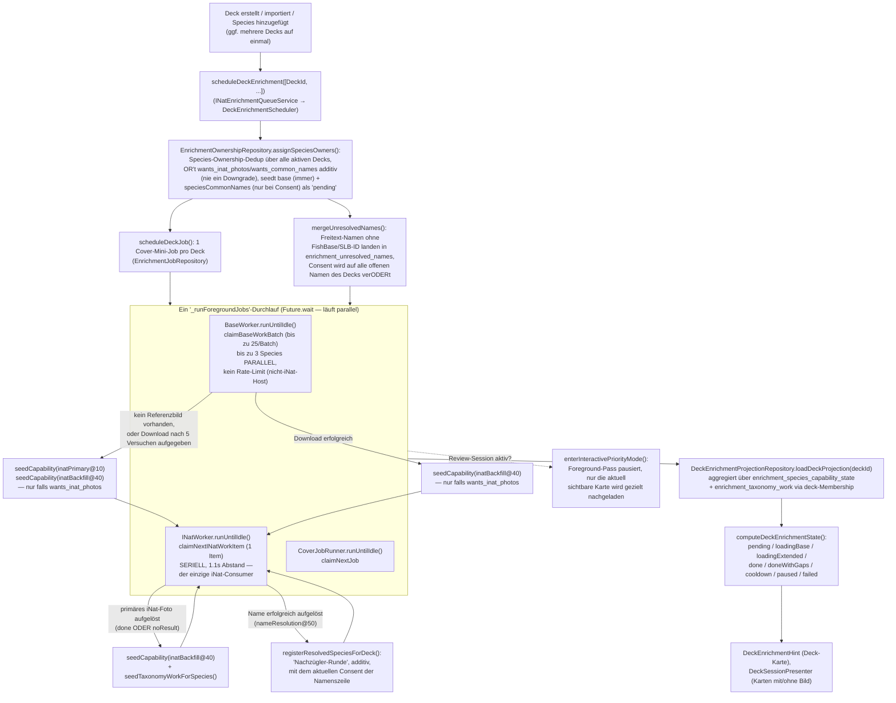
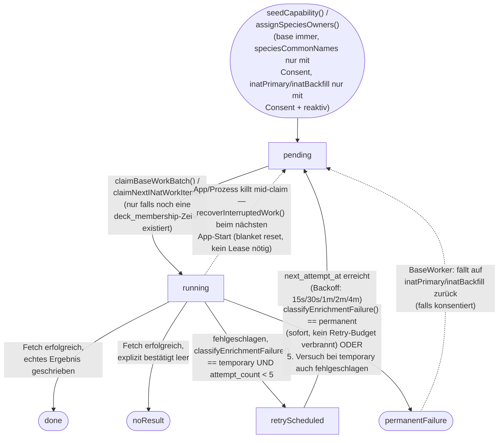
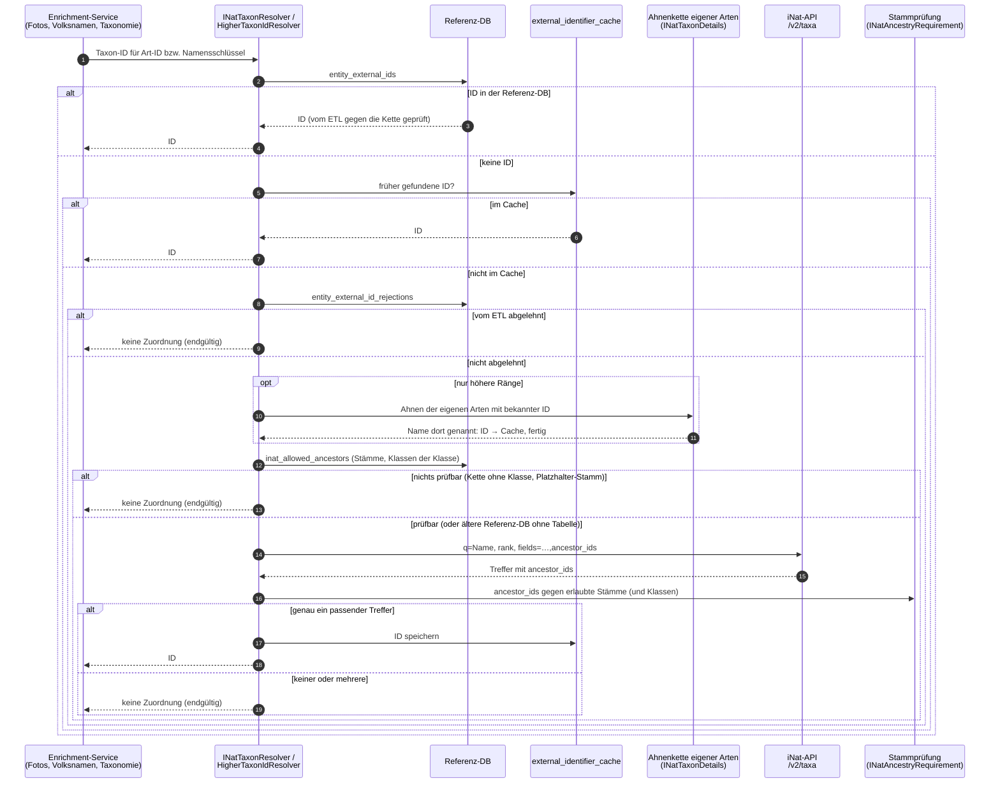

# iNaturalist-Enrichment — wie der Ablauf funktioniert

**Kategorie:** Architektur-Referenz (Ist-Zustand) · **Status:** Aktuell (Stand 2026-10-18)

Kurzreferenz für den aktuellen Enrichment-Ablauf: ein import-weites,
species-zentrisches Producer-Consumer-Modell mit zwei unabhängig laufenden
Workern über einer gemeinsamen, persistierten Prioritäts-Queue.

## Wozu

Nach Erstellen/Importieren eines Decks (oder Hinzufügen von Species zu einem
bestehenden Deck) reichert Discere jede Species im Hintergrund an:
Referenzbilder aus der ETL-Datenbank herunterladen, zusätzliche Fotos und
mehrsprachige Volksnamen von iNaturalist nachladen. Ziel: möglichst schnell
mindestens ein Bild pro Species, ohne die App zu blockieren.

## Ablauf

Die drei Worker (`BaseWorker`, `INatWorker`, `CoverJobRunner`) laufen **im
selben `Future.wait`-Durchlauf**, also echt nebenläufig zueinander.
Innerhalb von `BaseWorker` läuft zusätzlich echte Parallelität (`maxConcurrent
= 3`); `INatWorker` bleibt bewusst streng seriell, da es der einzige
Konsument des rate-limitierten iNat-Requestbudgets ist.

## Die zwei Worker im Detail

| Worker | Zieht aus | Capabilities | Nebenläufigkeit | Rate-Limit |
|---|---|---|---|---|
| `BaseWorker` | `claimBaseWorkBatch` (`enrichment_species_capability_state`, `capability = 'base'`) | `base` | bis zu 3 Species parallel, Batches à 25 | keiner (FishBase/SeaLifeBase, nicht iNat) |
| `INatWorker` | `claimNextINatWorkItem` (drei Quellen, niedrigster `priority_tier` gewinnt) | `inatPrimary` (10), `speciesCommonNames` (20), `taxonomyCommonNames` (30), `inatBackfill` (40), `nameResolution` (50) | streng seriell, 1 Item nach dem anderen | `1.1s` Abstand zwischen Claims |

`INatWorker` bündelt fünf Capabilities in **einer** Queue statt getrennter
Pfade — genau damit "ein rate-limitierter iNat-Konsument" eine echte Invariante
bleibt und nicht zwei unabhängige Pfade das Request-Budget gemeinsam
überziehen können. Die Namensauflösung (`nameResolution`) läuft deshalb an der
niedrigsten Prioritätsstufe in genau derselben Queue mit.

**Wichtige Vereinfachung:** `speciesCommonNames`/`taxonomyCommonNames` werden
immer als `'done'` markiert, sobald der Fetch terminal ist — es gibt keinen
Weg, von außen "echte Namen gefunden" von "bestätigt leer" zu unterscheiden
(`RuntimeCommonNameRepository` speichert den No-Result-Marker als ganz
normale Zeile in derselben Tabelle, die für "hat Namen" geprüft wird).
`inatBackfill` gate't die Deck-Bereitschaft nie (best-effort, "noch mehr
Fotos") — nur `base`/`inatPrimary` zählen für `imageStagesComplete`.

## Consent-Modell (additiv, nie ein Downgrade)

`includeINatPhotos`/`includeCommonNames` sind Parameter, die beim Schedulen
übergeben werden (keine persistente Deck-Einstellung). Sie werden **pro
Species** (nicht pro Deck) additiv verODERt in
`enrichment_species_work.wants_inat_photos`/`wants_common_names`:

- Eine Species, die einmal Consent von irgendeinem Deck bekommen hat, behält
  ihn — auch wenn ein anderes Deck, das dieselbe Species referenziert, ihn
  ablehnt (`assignSpeciesOwners`).
- `seedCapability` prüft `wants_inat_photos` selbst, bevor es `inatPrimary`/
  `inatBackfill` reaktiv anlegt — ein Species, die nur zu einem Deck ohne
  iNat-Consent gehört, bekommt dadurch **nie** ein iNat-Foto angefragt, egal
  was mit ihrem Referenzbild passiert.
- Ein Schedule-Aufruf für Deck B darf niemals stillschweigend Consent für ein
  anderes, gerade noch laufendes Deck A hochziehen, nur weil beide dieselbe
  Species teilen und A "der Einfachheit halber" mit übergeben wird (dedup,
  siehe unten) — dafür wird für alle nur mitgeschleppten Decks explizit
  `false` übergeben, statt das Feld auszulassen.
- Dasselbe gilt für die **offenen Namen** eines Decks
  (`enrichment_unresolved_names`), also Namen, die erst der `INatWorker`
  zu einer Species auflöst: Jeder Schedule-Aufruf verODERt seinen Consent
  auf alle noch vorhandenen Namenszeilen der Decks, die er einplant — nicht
  nur auf die Namen, die er mitbringt (`mergeUnresolvedNames`). Eine Zusage,
  die nach dem Einreihen der Namen kommt, erreicht so auch die Species, die
  erst später dazukommen. Neue Zeilen entstehen nur für übergebene Namen;
  ein bereits aufgelöster Name (Zeile gelöscht) wird nicht erneut gesucht.
  Mitgeschleppte Decks bleiben auch hier unberührt.
- Die Nachzügler-Runde (`registerResolvedSpeciesForDeck`) liest den Consent
  in ihrer Transaktion frisch aus der Namenszeile, nicht aus dem Stand beim
  Claim — so greift auch eine Zusage, die eintrifft, während der Name gerade
  aufgelöst wird. Fehlt die Zeile, schreibt sie nichts — keine Membership,
  keine `species_work`-Zeile, keine Capability; eine Species, die andere
  Decks verfolgen, bleibt unverändert. Das ist der Fall, wenn das Deck
  währenddessen gelöscht wurde oder die Diagnose alle offene Arbeit verworfen
  hat; ein späteres Einplanen des Decks nimmt die Species wieder auf. Die
  Prüfung in der eigenen Transaktion genügt gegen ein paralleles
  `releaseDeck`, denn das löscht Memberships und Namenszeilen des Decks in
  einer Transaktion: Entweder läuft es vorher (die Zeile fehlt), oder danach
  (es entfernt auch die neue Membership).
- Nachzügler-Runde und Einplanung laufen unter derselben
  `DeckMembershipLock` nacheinander, nie verschränkt. `assignSpeciesOwners`
  behandelt den Arten-Snapshot eines Decks als verbindlich und würde eine
  Species, die der `INatWorker` zwischen Snapshot und Schreiben registriert,
  wieder entfernen. So landet die Runde ganz vor dem Snapshot (die Species
  ist darin, die Zusage erreicht sie über `assignSpeciesOwners`) oder ganz
  nach dem Merge der offenen Namen (sie liest die Zusage aus der Namenszeile).

## Retry-/Resume-Strategie

Jede Capability-Zeile (`enrichment_species_capability_state`,
`enrichment_taxonomy_work`, `enrichment_unresolved_names`) durchläuft
denselben Zustandsautomaten — unabhängig davon, ob es eine Species-, eine
Taxonomie- oder eine Namensauflösungs-Zeile ist:

Wichtige Details dazu:

- **Klassifizierung vor Retry-Entscheidung** (`classifyEnrichmentFailure`,
  geteilt mit `CoverJobRunner`): `TimeoutException`/`http.ClientException`/
  ein retrybarer `HttpDownloadException` gelten als `temporary` (volles
  5-Versuche-Backoff-Budget); alles andere — inklusive eines nicht-retrybaren
  `HttpDownloadException` (z. B. 404) — gilt als `permanent` und gibt sofort
  auf, statt ~7 Minuten Backoff für einen Fehler zu verbrennen, der ohnehin
  nie erfolgreich gewesen wäre.
- **Crash-Recovery ist ein blanket reset, kein Lease-System:** Anders als
  `EnrichmentJobRepository`'s Job-Leases (mehrere mögliche Runner-Instanzen)
  gibt es pro Prozess genau einen `BaseWorker`/`INatWorker`. Jede beim letzten
  Absturz `running` gebliebene Zeile wird beim nächsten App-Start blanket auf
  `pending` zurückgesetzt (`recoverInterruptedWork()`, über
  `EnrichmentStartupMaintenance` aufgerufen in
  `INatEnrichmentQueueService._initialize()`).
- **Claims respektieren cross-deck Löschungen:** `claimBaseWorkBatch`/
  `claimNextINatWorkItem` claimen eine Species-Zeile nur, wenn noch
  mindestens eine `enrichment_species_deck_membership`-Zeile für sie
  existiert. Wurde das letzte Deck, das eine Species referenziert hat,
  gelöscht (`releaseDeck`), bleibt ihre `enrichment_species_capability_state`-
  Zeile zwar als permanenter Dedup-Cache liegen (siehe unten), wird aber nie
  wieder geclaimt — kein verschwendeter Download/iNat-Request für ein Deck,
  das nicht mehr existiert.
- **Reaktive Folge-Arbeit statt Batch-weiter Gates:** `BaseWorker` seedet bei
  Fehlschlag/fehlendem Referenzbild `inatPrimary`+`inatBackfill`; `INatWorker`
  seedet nach einer aufgelösten `inatPrimary` zusätzlich `inatBackfill` +
  ggf. Taxonomie-Arbeit; ein aufgelöster Name registriert die Species
  additiv nach ("Nachzügler-Runde", `registerResolvedSpeciesForDeck`). Jede
  dieser Folge-Seeds ist idempotent (`ConflictAlgorithm.ignore`) und
  respektiert dieselbe Consent-Prüfung wie oben.
- **Host-Cooldown ist rein informativ:** `HostCooldownTracker` (gespeist von
  `LoggingHttpClient`s HTTP-Fehlerprotokoll) gate't keine Requests der Worker
  selbst — die eigentliche Drosselung passiert ausschließlich über die
  Backoff-Schritte pro Capability-Zeile oben. Der Tracker steuert nur die
  `DeckEnrichmentState.cooldown`-Anzeige und ob die Android-Foreground-
  Service-Notification aktiv bleiben soll.
- **Restart-Wunsch bei laufendem Durchlauf:** `_ensureForegroundRunner()`
  markiert einen Restart-Wunsch, wenn es während eines bereits laufenden
  `_runForegroundJobs()`-Durchlaufs aufgerufen wird, damit kurz hintereinander
  geschedulte Arbeit (z. B. zwei `scheduleDeckEnrichment`-Aufrufe) im selben
  Zyklus abgearbeitet wird, statt bis zum nächsten unabhängigen Ereignis
  (App-Resume, Netzwerkwechsel) liegen zu bleiben.
- **Begrenzte native DB-Opens:** `DatabaseHelper._openReferenceDb`/
  `_openUserDb` begrenzen den nativen Open-Call mit einem 8s-Timeout. sqflites
  natives Handle ist prozessweit pro Pfad; ein verklemmtes Handle würde einen
  `openDatabase()` sonst unbegrenzt hängen lassen und den gecachten
  Initialisierungs-`Future` für immer offenhalten, sodass jeder spätere Zugriff
  (Retry-Tap auf dem Bootstrap-Error-Screen, ein späterer Repository-Call) auf
  demselben toten Future wartet. Nach dem Timeout greift der `catchError`-Reset
  auf `_referenceInitialization`/`_userInitialization`, sodass der nächste
  Zugriff ein frischer Open-Versuch ist. `DeckEnrichmentStatusStore.pullChanges()`
  behandelt eine `TimeoutException` wie eine geschlossene Datenbank (Abgleich
  verworfen, Cursor bleiben stehen), damit ein Timeout beim allerersten
  DB-Zugriff `_initialize()` nicht abbricht, bevor Lifecycle-Observer und
  Foreground-Runner aufgesetzt sind. `main.dart` schließt bei
  `AppLifecycleState.detached` (Engine-Teardown, z. B. wenn Android die Activity
  killt, während der Foreground-Service den Prozess am Leben hält) beide
  Datenbanken via `DatabaseHelper.close()`.
- **Geschlossene DB vs. echter DB-Fehler:** Runner-Durchlauf, Worker-Schleifen,
  Statusabgleich und die Einplanungen der Queue laufen nicht abgewartet und
  können die Datenbank überdauern. Sie tolerieren genau diesen Fall über
  `toleratingClosedDatabase` (`shared/persistence/closed_database_tolerance.dart`)
  und verwerfen die Arbeit still. Jeder andere Datenbankfehler propagiert: an
  einen wartenden Aufrufer (z. B. `scheduleDeckEnrichment` an den Import-Flow)
  oder, wenn niemand wartet, als unbehandelter Fehler ins Diagnose-Log
  (Scope `UncaughtError`). Fehler *innerhalb* eines Work-Items fängt der Worker
  selbst und verbucht sie als Fehlversuch des Items.
- **Membership überlebt die Fertigstellung:** `enrichment_species_deck_membership`
  ist die Speziesliste eines Decks und der Nenner, aus dem
  `DeckEnrichmentProjection` (`speciesCount`, `imageStagesComplete`, `done`,
  Progress, `isReady`) berechnet wird. Eine fertig-enrichte Species behält ihre
  Membership-Zeile also, solange das Deck sie referenziert — nur so bleibt das
  Deck als `done` berechenbar, und `loadDeckIdsUpdatedSince`'s Delta-Query sieht
  die finale Terminal-Änderung über den erhaltenen Join von selbst. Aufgeräumt
  werden Membership-Zeilen ausschließlich an den Lebenszyklus-Punkten, an denen
  sie wirklich obsolet werden: Species aus dem Deck entfernt (Drop-Loop in
  `assignSpeciesOwners`), Deck gelöscht (`releaseDeck`), verwaistes Deck beim
  Start (`EnrichmentStartupMaintenance.pruneOrphanedWork`). `enrichment_species_capability_state` bleibt
  darüber hinaus als prozessübergreifender Dedup-Cache bestehen (auch für
  Species in keinem Deck), damit erneutes Hinzufügen dieselbe Enrichment nicht
  wiederholt.

## Mehrere Decks gleichzeitig / Cross-Deck-Dedup

`scheduleDeckEnrichment()` nimmt weiterhin eine **Liste** von Deck-IDs
entgegen. Die Dedup-Logik greift import-weit über alle Decks eines Aufrufs hinweg:

**1. Species-Ownership** (`EnrichmentOwnershipRepository.assignSpeciesOwners`,
Tabelle `enrichment_species_work`) — verhindert, dass dieselbe Species von
mehreren gleichzeitig aktiven Decks unabhängig voneinander bei iNat
angefragt wird:
- Jede Species bekommt genau ein `owner_deck_id` (Tie-Break-Bookkeeping,
  keine exklusive Kontrolle) — **jedes** referenzierende Deck bekommt aber
  eine Zeile in `enrichment_species_deck_membership`, und die
  `enrichment_species_capability_state`-Zeilen sind ohnehin global pro
  Species, nicht pro Deck. Ein Deck muss also nicht "Owner" sein, um von
  bereits fertiger Arbeit für eine geteilte Species zu profitieren.
- Einmal vergebene Ownership bleibt stabil, solange der Owner noch unter den
  beteiligten Decks ist. Bereits aktive Decks werden bei einem neuen
  `scheduleDeckEnrichment`-Aufruf mit niedrigerer Priorität einbezogen — nur
  um ihre Species-Zuordnung zu schützen, ohne ihnen selbst neuen Consent zu
  gewähren (siehe Consent-Modell oben).
- `enrichment_species_capability_state` ist der **permanente** Dedup-Cache:
  wird eine Species aus jedem Deck entfernt (`releaseDeck`), bleibt diese
  Zeile bestehen — kommt die Species später in einem neuen Deck wieder vor,
  muss nichts doppelt geholt werden.
- Löscht das Deck, das gerade `owner_deck_id` einer geteilten Species ist,
  wird die Ownership auf ein verbleibendes Deck übertragen statt die
  Species-Zeile (und damit die Arbeit anderer Decks) einfach zu verwerfen.

**2. Taxonomie-Dedup** (`assignTaxonomyOwners`/`enrichment_taxonomy_work`,
Schlüssel `rank + taxon_id` bzw. `rank + scientific_name`) — Genus-/Familien-/
Ordnungs-/Klassen-Volksnamen werden einmal pro Taxon geholt, nicht einmal pro
Species darin, unabhängig davon, wie viele Decks/Species darauf verweisen.

## Die iNat-Taxon-ID einer Art oder eines höheren Rangs

Fotos und Volksnamen holt die App von iNaturalist immer über eine
Taxon-ID. Woher diese ID kommt, entscheidet über richtig oder falsch: Ein
Name allein trennt keine Homonyme — die Schnecke *Triphora pusilla* heißt
wie eine Orchidee, die Borstenwurm-Gattung *Megalomma* wie ein
Sandlaufkäfer. Grundsatz: lieber keine Zuordnung als eine falsche, also
keine Fotos und Namen eines anderen Lebewesens.

Arten löst `INatTaxonResolver` auf, für den Foto-, den Volksnamen-Worker
und den Live-Abruf der Artseite (`SpeciesPhotoService`); höhere Ränge
(Gattung, Familie, Ordnung, Klasse) für `TaxonomyCommonNameEnrichmentService`
löst `HigherTaxonIdResolver` auf. Beide fragen iNaturalist über
`INatTaxonIdResolver` (`external/inaturalist/`):

1. **Referenz-DB** (`entity_external_ids`: Art-ID bzw. Namensschlüssel wie
   `genus:megalomma`) — wird unverändert genommen. Der ETL hat diese IDs
   gegen die eigene Kette geprüft: Stamm, dazu Klasse, Ordnung oder Familie
   (siehe [`etl/docs/datenquellen.md`](../etl/docs/datenquellen.md#stamm-und-kette-bei-der-inaturalist-zuordnung)).
2. **Cache** (`external_identifier_cache`, Schlüssel = Art-ID bzw.
   Entity-Key) — eine früher über die folgenden Schritte gefundene ID.
3. **Ablehnungen des ETL** (`entity_external_id_rejections`): Hat der ETL
   für diese Art bzw. diesen Namensschlüssel ein Taxon ihres Namens gesehen
   und bewusst nicht genommen — anderer Stamm, nicht prüfbar, Namensträger
   in mehreren Stämmen oder Klassen, Synonym einer anderen Familie, mehrere
   passende Taxa —, sucht die App nicht selbst: Sie fände dieselben Taxa
   wieder und prüft nur den Stamm. Die Art bzw. der Eintrag bleibt
   endgültig ohne iNat-Fotos und -Namen (`TaxonNotFoundException` bzw.
   `HigherTaxonAbsent`: leere Markierung in `inat_photo_cache`, `__none__`
   in `runtime_common_names`). Bei einem höheren Rang entfällt auch die
   Ahnenkette: Der Schlüssel steht für alle gleichnamigen Zeilen, und was
   die Kette einer Art fände, wäre für eine andere Zeile falsch.
4. **Nur höhere Ränge — Vorfahrenketten der eigenen Arten:** Die
   Detail-Dokumente der Arten des Eintrags (`INatTaxonDetails`, Feld
   `ancestors`) nennen alle höheren Taxa, unter denen iNat die Art führt.
   Steht der wissenschaftliche Name dort, ist es nachweislich dasselbe
   Taxon — auch auf einem anderen Rang (Elasmobranchii ist bei iNat eine
   Unterklasse), und ein Homonym an anderer Stelle im Baum (Articulata:
   Armfüßer-Klasse hier, Seelilien-Unterklasse dort) kann nicht treffen. Ein
   Treffer auf dem angefragten Rang gewinnt, sonst zählt nur ein einziger
   Treffer auf einem anderen Rang. Gelesen werden höchstens die ersten 30
   Arten mit bekannter iNat-ID (sortiert), also ein gebündelter Request —
   oft keiner, weil die Foto-Anreicherung dieselben Dokumente schon geladen
   hat.
5. **Namenssuche mit Stammprüfung** (`/v2/taxa?q=…&rank=…`, mit
   `ancestor_ids` im selben Request). Was zur eigenen Kette passt, liest die
   App aus `inat_allowed_ancestors`: je eigener Klasse die iNat-IDs der
   passenden Stämme (und Klassen), vom ETL aus denselben Listen
   gleichwertiger Namen abgeleitet wie seine eigene Prüfung
   (`INatAllowedAncestorRepository`). Die reine Prüfung ist
   `INatAncestryRequirement.isMetBy`.
   - **Arten** (`INatTaxonIdResolver.resolve`, über alle Namen aus
     `scientificNameCandidates`): Ein Treffer muss einen erlaubten Stamm der
     Klasse der Art in seinen `ancestor_ids` tragen. Ein Treffer mit genau
     dem Namen gewinnt; nur ohne passenden solchen zählt ein Synonym-Treffer
     (`matched_term`) — iNaturalist führt eine Art oft unter neuer Gattung.
     Eine Art ohne Kette bis zur Klasse (etwa ohne Gattung) oder mit
     Platzhalter-Stamm wird nicht gesucht: Es gäbe nichts, woran ein
     Homonym zu erkennen wäre.
   - **Höhere Ränge** (`INatTaxonIdResolver.resolveExact`): nur ein Treffer
     mit genau diesem Namen auf genau diesem Rang, kein Synonym-Treffer
     (`matched_term` — Sebastidae träfe so Scorpaenidae). Unterhalb der
     Klasse genügt der Stamm nicht — innerhalb eines Stamms wiederholen sich
     Gattungsnamen —, der Treffer muss auch unter einer erlaubten Klasse
     liegen. Ein Namensschlüssel steht für jede gleichnamige Zeile der
     Rangtabelle mit einer Art darunter; der Treffer muss zu jeder passen.
     Eine Zeile ohne Kette bis zur Klasse oder eine Klasse, die iNaturalist
     nicht führt, macht die Suche für den Schlüssel unmöglich.
   - **Nie das erste Ergebnis** für ein fehlendes besseres, und nie eines von
     zwei gleich passenden: Bleibt nicht genau ein Taxon übrig, gibt es keine
     Zuordnung, und die Antwort ist endgültig.

   Mit einer **älteren Referenz-DB** ohne die beiden Tabellen (refdb-v2)
   kennt die App weder Ablehnungen noch erlaubte Stämme. Dann entscheidet
   allein der Name, mit denselben Regeln: genau ein Treffer mit diesem Namen
   bzw. ein Synonym-Treffer, nie das erste Ergebnis. Ob die Tabellen da sind,
   prüft `OptionalReferenceTable` einmal je geöffneter Datenbank.

Eine über 4. oder 5. gefundene ID wird im Cache gespeichert; der `work_key`
eines später geplanten höheren Eintrags wird daraus gebildet
(`<rang>:taxon:<id>`). Ein gescheiterter Request ist keine Antwort: Der
Eintrag bleibt offen, und der Retry-Weg oben greift.

**Fehler ≠ leer.** Endgültig "keine Namen" (die `__none__`-Markierung in
`runtime_common_names`, Arbeit `done`) gibt es nur, wenn die Antwort
feststeht: vom ETL abgelehnt, nichts prüfbar, Taxon in keiner Kette und kein
passender Treffer der exakten Suche, oder Taxon gefunden, aber ohne Namen.
Jeder Fehler — Nicht-200, Timeout, ein gescheiterter Detail-Abruf, ein
gescheiterter Namensabruf trotz bekannter ID — lässt den Eintrag offen, und
der Retry-Weg oben greift.

**Bekannte Lücke: Teleostei.** Die Klasse Teleostei (rund 34 600 Arten der
Referenz-DB) gibt es bei iNat nicht, weder in den Ketten noch per Suche. Sie
behält den englischen Namen der Referenz-DB. Die Namen von Actinopterygii
wären falsch — ein anderes, übergeordnetes Taxon. Abhilfe nur über eine
andere Namensquelle als iNaturalist.

**Bekannte Lücke: Daten aus der Zeit ohne Prüfung.** Auf Geräten, die vor
dieser Prüfung angereichert haben, kann `external_identifier_cache` IDs aus
der damaligen Suche enthalten (die das erste Ergebnis nahm und keinen Stamm
prüfte), dazu Fotos (`inat_photo_cache`, ohne Taxon-ID) und Volksnamen
(`runtime_common_names`) dieser Taxa. Die App nimmt eine ID aus dem Cache
ungeprüft (Schritt 2), und abgeschlossene Arbeit wird nicht wiederholt. Wie
diese Daten beim Einspielen einer neuen Referenz-DB verworfen werden, ist
offen ([#342](https://github.com/discere-app/discere/issues/342)).

**Bekannte Lücke: Vorschaubilder der Suche.** `INatPhotoApi.fetchThumbnailUrl`
(Suchergebnisse, Taxonomie-Listen, Arten hinzufügen) sucht ein Vorschaubild
nur über den Namen, ohne Referenz-DB-ID, Ablehnungen und Stammprüfung — mit
denselben Regeln wie eine ältere Referenz-DB (kein erstes Ergebnis). Es
speichert nichts, zeigt aber womöglich das Bild eines gleichnamigen
Lebewesens.

## Referenz-DB-Version & Basisbild-Refresh

Jede terminal-markierte `base`-Capability-Zeile trägt zusätzlich
`reference_db_version` — die `ReferenceDatabaseProvisioner`-Version
(`shared/persistence/`), die zum Zeitpunkt des Abschlusses installiert war
(`BaseWorker._runOne`, gestempelt sowohl bei `done` als auch `noResult`).
Damit lässt sich erkennen, welche Arten mit einer älteren Version der
Referenz-DB (FishBase/SeaLifeBase) angereichert wurden als aktuell
installiert ist — eine Zeile ohne Stempel (`NULL`, vor Einführung dieser
Spalte abgeschlossen) gilt ebenfalls als veraltet.

Drei unabhängige Wege, das aufzulösen — **immer nur manuell/nutzergetriggert,
nie automatisch**:

| Auslöser | Methode (`INatEnrichmentQueueService`) | Umfang | Betrifft |
|---|---|---|---|
| Einmaliger Dialog direkt nach einem Referenz-DB-Update (`main_screen_page.dart` → `maybeShowBaseRefreshPrompt`) | `refreshAllStaleBaseImages()` | app-weit | nur tatsächlich veraltete Arten |
| Edit-Deck-Hinweis "Nach aktuellen Bildern suchen" (sichtbar, sobald `staleBaseSpeciesCount > 0`) | `refreshStaleBaseImages(deckId)` | ein Deck | nur tatsächlich veraltete Arten des Decks |
| Edit-Deck "Erneut anreichern"/"Jetzt anreichern" (Basis/Vollständig-Auswahl über `showDeckDownloadChoiceDialog`) | `retriggerBaseEnrichment(deckId)` | ein Deck | **alle** terminalen `base`-Zeilen des Decks, inkl. `permanentFailure` — unconditional, keine Versionsprüfung |

Alle drei setzen die betroffenen `base`-Zeilen zurück auf `pending`, sodass
`claimBaseWorkBatch` sie beim nächsten `_runForegroundJobs()`-Durchlauf ganz
normal erneut claimt — kein Sonderpfad, dieselbe Producer-Consumer-Queue wie
beim ursprünglichen Import. Der dritte Weg existiert zusätzlich zu den ersten
beiden, weil `scheduleDeckEnrichment` allein für eine bereits terminale
`base`-Zeile ein No-op ist (`ConflictAlgorithm.ignore` auf dem Capability-
Insert) — ein manuelles "nochmal versuchen" braucht also den expliziten Reset,
sonst claimt `BaseWorker` nichts.

**Ein Reset heißt nicht automatisch ein echter Download:**
`BaseImageEnrichmentService` delegiert an `ImageService`, das den lokalen
Dateipfad rein aus `md5(Bild-URL)` ableitet und den HTTP-Request überspringt,
sobald diese Datei schon existiert (`ImageService._resolveExistingImagePath`).
Solange sich die Bild-URL einer Art nicht geändert hat — der Normalfall auch
bei einem Referenz-DB-Versionssprung — ist ein Reset also nur eine billige
Datei-Existenz-Prüfung, kein erneuter Download. `ImageService` loggt beide
Fälle (`Reusing cached image for ...` / `Downloading reference image from
...`), sodass sich das pro Art im Log nachvollziehen lässt.

## Runtime-Modell

- **Läuft komplett in der UI-Isolate**, kein separater Background-Isolate.
  `lib/app/background/inat_background_task.dart` existiert nur noch als
  No-Op-Callback für Workmanager-Wakeups von alten App-Versionen.
- Damit der Android-Prozess bei Bildschirm aus nicht vom OS beendet wird,
  hält `EnrichmentForegroundServiceKeeper` einen echten Android-Foreground-
  Service mit Notification am Laufen, solange Arbeit offen ist.
- Getriggert wird `_runForegroundJobs()` bei `scheduleDeckEnrichment()`, bei
  App-Start (`initialize()`) und bei jedem Wiedereintritt in den Vordergrund
  (`AppLifecycleState.resumed`) sowie bei Netzwerk-Wiederverbindung. Läuft
  nur, wenn online (`NetworkAvailability`).
- **Pausiert während einer aktiven Lern-Session:** `DeckPage` ruft beim
  Öffnen `enterInteractivePriorityMode()` auf — die drei Worker halten an,
  damit sie nicht mit dem gezielten Nachladen der gerade sichtbaren Karte
  um Bandbreite/DB-Zugriff konkurrieren.
- **Live-Fortschritt statt Sprung am Pass-Ende:** `BaseWorker`/`INatWorker`
  feuern einen `onProgress`-Callback nach *jeder einzelnen* verarbeiteten
  Species/Item, nicht erst wenn der komplette `_runForegroundJobs()`-Durchlauf
  fertig ist — sonst hätte die UI bei einem großen Batch (z. B. 20 Arten ×
  ~1.1s `INatWorker`-Taktung) minutenlang keinerlei sichtbare Bewegung.
  `INatEnrichmentQueueService._notifyProgress()` ruft dafür einfach
  `_refreshState()` auf — kein eigener Event-Bus nötig, da dieser Delta-Refresh
  selbst-koaleszierend ist (mehrere Aufrufe kollabieren zu einem Durchlauf,
  `notifyListeners()` feuert nur bei echter Änderung). `_refreshStateNow()`/
  `_syncCooldownStatus()` prüfen `_disposed` unmittelbar vor jedem
  `notifyListeners()` erneut (nicht nur am Funktionseinstieg), da zwischen
  Eintritt und `notifyListeners()` mehrere `await`-Punkte liegen (Delta-Queries,
  Projection-Reload, Foreground-Service-/Notification-Sync).

## Wichtige Komponenten

| Komponente | Pfad | Verantwortung |
|---|---|---|
| `INatEnrichmentQueueService` | `queue/service/` | Einstiegspunkt (`scheduleDeckEnrichment`); entscheidet, wann gearbeitet wird, und hält die drei Klassen darunter zusammen |
| `DeckEnrichmentScheduler` | `queue/service/` | Plant Decks ein und gibt sie frei: Arten-Snapshot, Besitz und Consent (`assignSpeciesOwners`), Cover-Job, offene Namen — ohne Runner und Status |
| `DeckMembershipLock` | `service/` | Serialisiert die Einplanung und die Nachzügler-Runde des `INatWorker`, die beide die Deck-Mitgliedschaft der Queue schreiben |
| `EnrichmentLifecycleCoordinator` | `queue/service/` | Übersetzt App-Lifecycle und Netzverfügbarkeit in `isInForeground` plus Resume-/Backoff-/Retry-Callbacks; serialisiert Übergänge und kollabiert Signal-Bursts |
| `ForegroundEnrichmentRunner` | `queue/service/` | Führt einen Durchlauf über Cover-Job, `BaseWorker` und `INatWorker` aus; kennt nur Start, Abbruchbedingung und Ende |
| `DeckEnrichmentStatusStore` | `queue/service/` | Hält den Deck-Zustand im Speicher (Delta-Laden, High-Water-Marks) und leitet `DeckEnrichmentState`/`DeckEnrichmentInfo` für die UI ab |
| `PauseVisibilityScheduler` | `queue/service/` | Hält Pausen und Host-Cooldowns zurück, bis sie lange genug dauern, um sie zu zeigen — und weckt die UI in dem Moment, in dem das eintritt |
| `EnrichmentBackgroundPresence` | `queue/service/` | Entscheidet, ob die App eine sichtbare Hintergrund-Präsenz für Enrichment hält (Android-Foreground-Service samt Notification) und was darin steht |
| `BaseWorker` | `pipeline/service/` | Zieht `base`-Arbeit, echte Parallelität, kein Rate-Limit |
| `INatWorker` | `pipeline/service/` | Einziger rate-limitierter iNat-Konsument über fünf Capabilities inkl. Namensauflösung |
| `CoverJobRunner` | `queue/service/` | Führt den Cover-Mini-Job aus (Lease/Retry) |
| `EnrichmentJobRepository` | `queue/repository/` | Eine Zeile pro Deck in `enrichment_jobs`: Lebenszyklus (Status, Lease, Retry) und `cover_state` |
| `EnrichmentOwnershipRepository` | `pipeline/repository/` | Wer welche Arbeit besitzt und wofür Einwilligung vorliegt. Schreibt `enrichment_species_work`, `enrichment_species_deck_membership` und `enrichment_species_capability_state` in einer Transaktion |
| `SpeciesOwnershipPlanner` | `pipeline/repository/` | Entscheidet Besitz und Consent für eine Deck-Menge — Dedup und additive Einwilligung, ohne Datenbank prüfbar |
| `EnrichmentWorkClaimRepository` | `pipeline/repository/` | Was in der Queue liegt und wer es als Nächstes nimmt (`seedCapability`, die beiden `claim*`-Methoden) |
| `EnrichmentWorkOutcomeRepository` | `pipeline/repository/` | Wie ein Versuch ausging: terminal, Retry geplant, aufgegeben |
| `EnrichmentWorkMaintenanceRepository` | `pipeline/repository/` | Betriebliche Rücksetzungen außerhalb der Worker-Schleife: veraltete Bilder, Retrigger, Absturz-Recovery, Diagnose-Abbruch |
| `DeckEnrichmentProjectionRepository` | `pipeline/repository/` | Liest dieselben Tabellen, ohne sie zu ändern: Deck-Projektion, Delta-Abfrage, Diagnose-Zählungen |
| `DeckProjectionBuilder` | `pipeline/repository/` | Faltet die Zeilen einer Deck-Projektion zusammen — hier liegen die deck-seitigen Regeln, ohne Datenbank prüfbar |
| `BaseImageEnrichmentService` / `INatPhotoEnrichmentService` / `SpeciesCommonNameEnrichmentService` / `TaxonomyCommonNameEnrichmentService` | `pipeline/service/` | Die eigentlichen Fetches pro Species/Taxon, aufgerufen von den beiden Workern |
| `INatTaxonResolver` | `pipeline/service/` | iNat-Taxon-ID einer Art: Referenz-DB → Cache → Ablehnungen → Namenssuche mit Stammprüfung (siehe "Die iNat-Taxon-ID") |
| `HigherTaxonIdResolver` | `pipeline/service/` | iNat-Taxon-ID eines höheren Rangs: Referenz-DB → Cache → Ablehnungen → Vorfahrenketten der Arten → exakte Suche mit Stamm- und Klassenprüfung (siehe "Die iNat-Taxon-ID") |
| `ExternalIdRejectionRepository` / `INatAllowedAncestorRepository` | `catalog/repository/` | Lesen die Ablehnungen und die erlaubten iNat-Stämme und -Klassen je Klasse aus der Referenz-DB; ohne die Tabellen (ältere Referenz-DB) keine Ablehnung bzw. keine Prüfung |
| `INatNameResolutionService` | `pipeline/service/` | Löst Freitext-Namen gegen iNat auf (`ScientificNameResolutionPort`) |
| `EnrichmentForegroundServiceKeeper` | `queue/service/` | Android-Foreground-Service-Notification, solange Arbeit offen ist |
| `HostCooldownTracker` | `shared/service/` | Rein informativ: UI-Cooldown-Anzeige + Keepalive-Signal, gate't keine Requests |
| `ReferenceDatabaseProvisioner` | `shared/persistence/` | Download/Installation der Referenz-DB; `currentVersion()` wird von `BaseWorker` beim Terminal-Markieren von `base` gestempelt und für die Staleness-Erkennung oben gelesen |

## Wo die UI das liest

- `DeckEnrichmentHint` (Deck-Karte) zeigt Status-Icon + Text aus
  `DeckEnrichmentInfo`/`DeckEnrichmentState` (`pending`, `loadingBase`,
  `loadingExtended`, `done`, `doneWithGaps`, `cooldown`, `paused`, `failed`).
  Ein Fortschritts-Prozentsatz (`progressCompleted`/`progressTotal` aus
  `deriveDisplayedProgress`, gerundet) wird bewusst erst ab `loadingExtended`
  angezeigt — also erst sobald das Deck tatsächlich lernbar ist
  (`imageStagesComplete`, ein Bild-Ergebnis pro Species). Im `loadingBase`-
  Zustand (Deck noch nicht lernbar) gibt es nur den reinen Statustext, keine
  Zahl — eine Prozentangabe hätte sonst "80%" wie "80% lernbereit" lesen
  lassen, obwohl noch gar nichts davon stimmt. `progressTotal` ist dabei kein
  reiner Artenzähler, sondern eine Summe über mehrere Capability-Zähler
  (Basisbild pro Species + Common-Names-Consent-Species + Backfill-Species +
  Taxonomie-Einträge je Genus/Familie/… + optional 1 für den Cover-Job) —
  ein Deck mit 10 Arten kann je nach Consent/Taxonomie-Lage einen `total`
  deutlich über 10 haben.
- `DeckSessionPresenter.filterReviewableCards` entscheidet pro Flashcard: ist
  `DeckEnrichmentProjection.imageStagesComplete` (= `base`+`inatPrimary` für
  alle Species terminal) noch `false`, werden fällige Karten ohne lokales
  Bild versteckt; ist es `true`, werden alle fälligen Karten gezeigt, auch
  ohne Bild.
- `ManualINatEnrichmentSection` (Edit Deck) zeigt zwei unabhängige Karten: den
  normalen Anreicherungs-Status/Trigger-Button, und — nur wenn
  `staleBaseSpeciesCount > 0` — eine zweite Karte mit dem
  "Nach aktuellen Bildern suchen"-Button (siehe Abschnitt oben).
- **Bekannter, akzeptierter Trade-off:** `DeckEnrichmentInfo.lastCompletedAt`/
  `lastAttemptedAt` nutzt für Decks ohne echten Cover-Download (kein
  Cover-URL, also ein Cover-Job ohne `completed_at`) einen nur session-scoped
  In-Memory-Zeitstempel, da Species-/Taxonomie-Arbeit keine einzelne,
  deck-weite persistente Zeitstempel-Spalte mehr hat — nach einem App-Neustart
  zeigt so ein Deck "zuletzt abgeschlossen" ggf. nicht mehr an, auch wenn es in
  einer früheren Session fertig wurde. Ein Deck mit echtem Cover-Download
  (`completed_at` gesetzt) ist davon nicht betroffen.
- **Fehlt aktuell:** eine Deck-weite, persistente Aussage "für N Species
  wurde kein Foto gefunden" — dazu mehr in
  [GitHub Issue #53](https://github.com/discere-app/discere/issues/53).
